

  

<h1 align="center">Rastreio-DB</h1>

  <a href="https://github.com/pedro-f-97/rastreio-db/releases/latest">⬇️ Download da versão mais recente</a>

  <strong>Python • FastAPI • React • SQLite • SQLAlchemy • PyInstaller</strong>

Aplicação web local e portable para gestão e análise de extratos bancários, sem dependência de serviços externos. Nasceu da necessidade de algo mais robusto do que a típica folha de Excel. Permite importar extratos em Excel (.xlsx, .csv), com perfis configuráveis por banco e conta, categorizar transações automaticamente com regras dinâmicas, marcar transações como património para registo de bens ou investimentos, e acompanhar a evolução financeira através de estatísticas detalhadas.

### Transações
- Listagem paginada com edição inline de categoria, subcategoria, conta e notas
- Filtros por ano, mês e categoria, incluindo filtro rápido de transações por categorizar
- Histórico com totais por ano/mês e drill-down por categoria
- Categorização automática por regras de substring, com sugestões automáticas de novas regras
- Aplicação de regras em massa, com resolução individual de conflitos
- Importação de Excel e CSV (separado por vírgula, ponto e vírgula ou tabulação, detetado automaticamente), com perfis de mapeamento de colunas por banco e conta, com deteção automática de duplicados

### Análise
- Estatísticas mensais: evolução, médias e medianas por categoria, distribuição com drill-down para subcategorias, taxa de poupança e totalizadores anuais
- Ativos: registo de investimentos (ex. ETFs, ações, cripto) e bens (ex. imóveis, viaturas), com histórico de compras, vendas e atualização de preços
- Património: acompanhamento de liquidez, ativos, bens, valorização ao longo do tempo e totais por tipo

### Configuração
- Categorias e subcategorias totalmente configuráveis, com tipo (`despesa`, `receita`, `investimento`, `transferencia`) e toggle para tratamento de património
- Regras de categorização automática
- Gestão de contas bancárias
- Gestão de tipos de ativos

### Geral
- Tema claro/escuro com persistência entre sessões
- Backup e restauro da base de dados, com auto-backup de segurança antes de cada restauro
- Página de primeiro uso com criação opcional de categorias standard, seguido de tour guiado interativo
- Página de Conceitos com explicação das principais áreas e workflow da aplicação

## Preview

### Transações (edição inline, filtros e categorização)
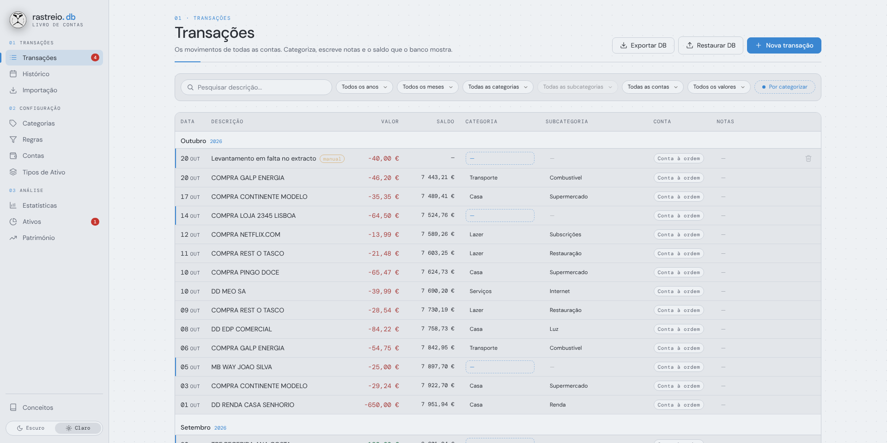

### Estatísticas (evolução mensal, distribuição por categoria e taxa de poupança)
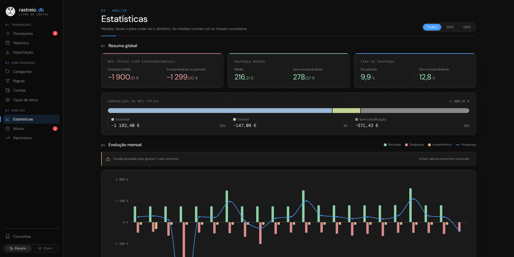

### Património (visão global dos ativos e desempenho)
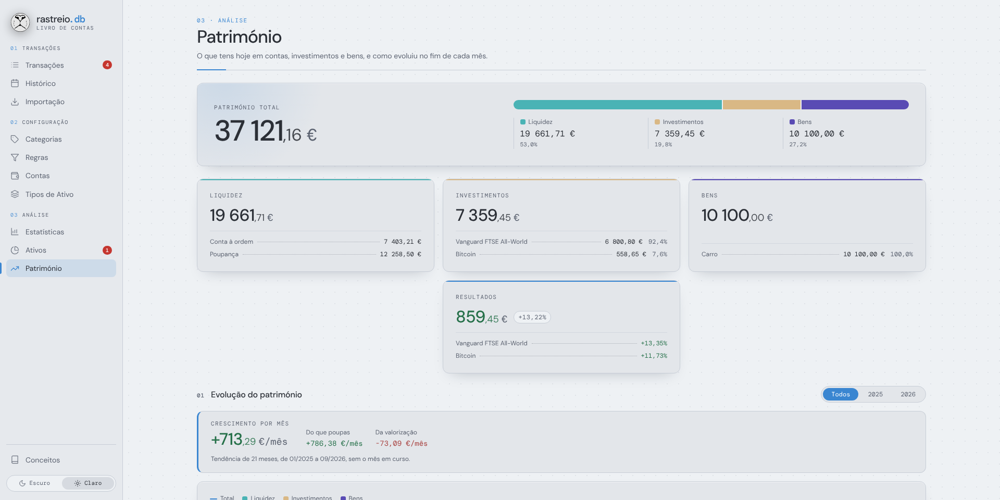

Mais screenshots (Importação, Categorias, Regras, Histórico, Contas e Configuração)

### Importação
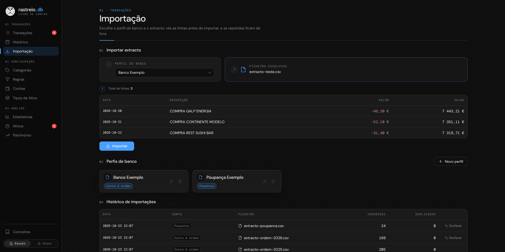

### Menu de importação
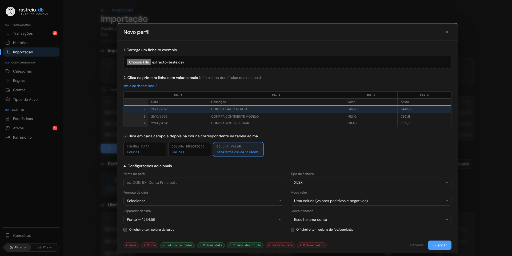

### Categorias
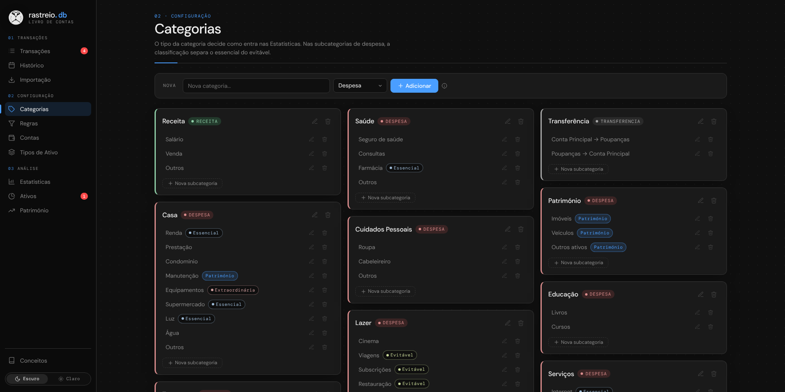

### Regras de categorização automática
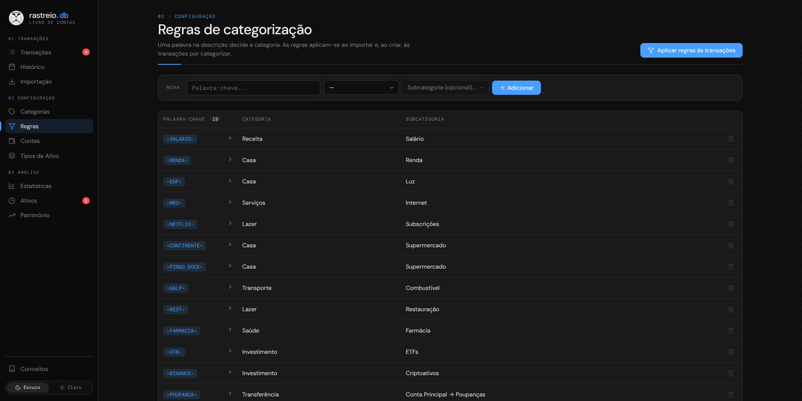

### Histórico
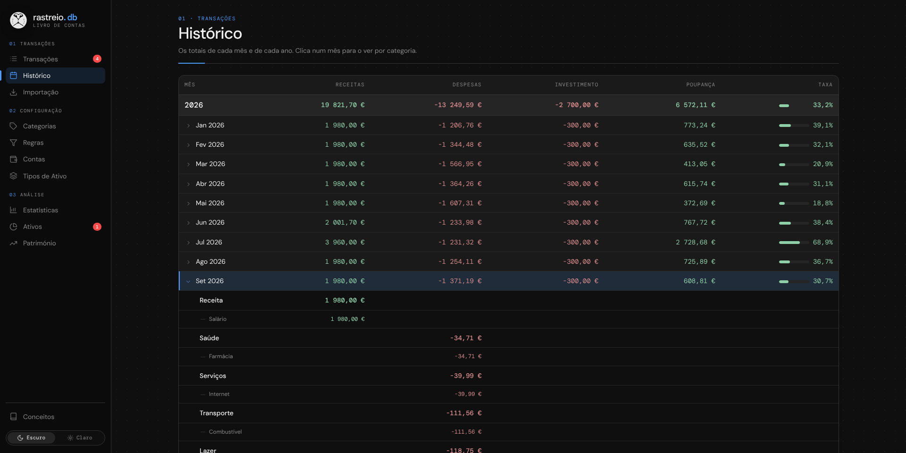

### Contas
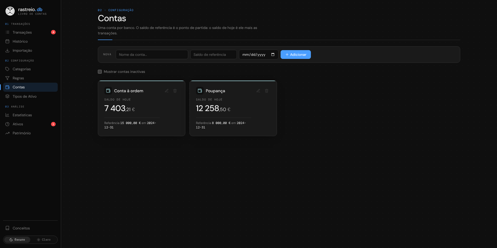

### Ativos
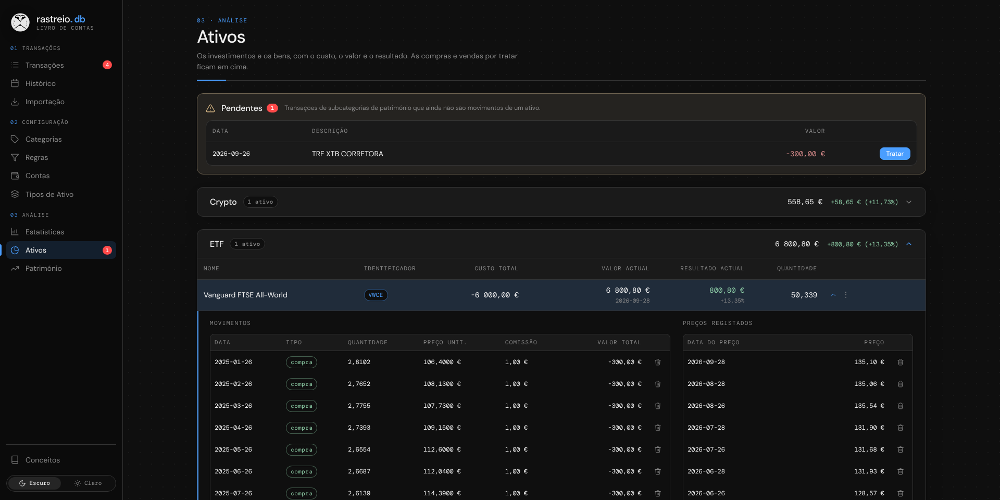

### Tipos de ativo
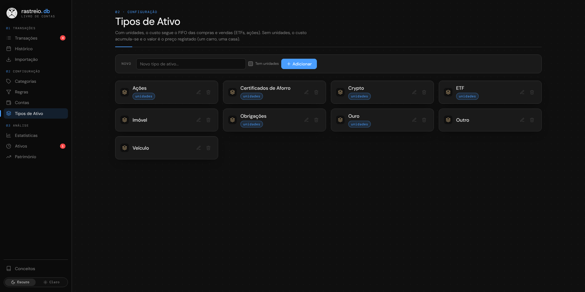

### Tratar ativo (contabilização FIFO)
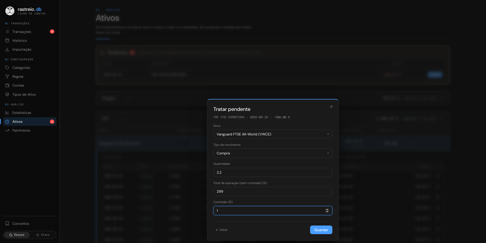

### Conceitos

## Categorias

As categorias e subcategorias são totalmente configuráveis. Cada categoria tem um `tipo` que determina o seu papel nas estatísticas e cada subcategoria tem um indicador que define se as respectivas transações representam património:

| Tipo | Papel nas estatísticas |
|---|---|
| `despesa` | Incluída nos totais de despesa e nas médias por categoria |
| `receita` | Incluída nos totais de receita e no cálculo da taxa de poupança |
| `investimento` | Tratada separadamente, não distorce despesa nem receita |
| `transferencia` | Excluída de todas as métricas (movimentos internos entre contas) |

Na primeira utilização, é possível carregar um conjunto de categorias predefinidas como ponto de partida, ou começar do zero.

## Património

Transações de subcategorias marcadas com o indicador de património alimentam o módulo de Património. Cada ativo é classificado como:

| Classificação | Papel |
|---|---|
| Investimento | Património com retorno expectável (ex. ETFs, ações, cripto) — conta para o cartão de Investimentos |
| Bem | Património sem retorno expectável (ex. imóvel, viatura) — conta apenas para o total de património |

## Decisões de design

- Reembolsos são tratados como redução de despesa, não como receita, para efeitos de estatísticas: um reembolso regista-se na categoria de despesa a que diz respeito, e o valor positivo reduz a despesa. Não há marca de reembolso; o tipo da categoria e o sinal decidem tudo, da mesma forma em todos os ecrãs
- Transferências internas são excluídas de todas as métricas para não distorcer os dados reais
- Uma categoria com transações não se pode apagar (é preciso mudá-las de categoria primeiro); sem transações, apaga-se com as suas subcategorias e regras. Apagar uma subcategoria deixa as suas transações por categorizar na mesma categoria, e as regras que apontavam para ela ficam sem subcategoria
- Uma conta com transações não se pode apagar, só desactivar. Desactivar esconde-a das listas de contas, mas a conta continua a contar no património e na sua evolução; na página Património aparece, marcada como inactiva, enquanto o saldo não for zero
- O saldo de referência de uma conta é o saldo no fim da data de referência, que pode ser qualquer dia (por exemplo, o de hoje). O saldo noutro dia calcula-se a partir dele: para a frente somam-se as transações seguintes, para trás tiram-se as que ainda não tinham acontecido
- Um bem sem unidades (ex. imóvel, viatura) vende-se sempre por inteiro: qualquer venda desconta o custo acumulado todo e o bem deixa de contar para o património. Para vender partes de um bem, regista-se o bem com unidades (ex. 100 unidades = 100%), e as vendas parciais passam pelo FIFO
- As médias mensais das estatísticas contam todos os meses que têm transações, incluindo os que só têm transferências ou transações por categorizar; pressupõe-se que as transações importadas são categorizadas logo a seguir à importação
- Uma importação é tudo ou nada: basta uma linha com erro (data inválida, valor que não bate com o separador decimal do perfil, linha de totais no fim do extracto) para o ficheiro inteiro ser recusado, e a pré-visualização mostra todas as linhas com erro
- Na importação, uma linha igual a outra já existente na conta (mesma data, descrição, valor e saldo) é duplicada, mas conta-se quantas cópias há: entram as linhas iguais que o extracto traz a mais do que a conta já tem (dois cafés iguais no mesmo dia, um deles só no extracto seguinte)
- Um perfil de importação tem sempre uma conta: as transações sem conta contariam nas estatísticas mas nunca na liquidez. Um perfil que perca a conta deixa de poder importar
- A coluna de comissão de um perfil de importação é sempre tratada como um pagamento: entra com sinal negativo, venha positiva ou negativa no extracto
- No modo de duas colunas de um perfil de importação, o débito sai sempre e o crédito entra sempre, venha o sinal que vier no extracto: o valor é `|crédito| − |débito|`, porque há bancos que escrevem o débito com sinal menos
- O sistema de regras usa correspondência por substring intuitiva
- Quando várias regras casam com a mesma descrição, ganha a de palavra-chave mais longa (a mais específica) e, em empate, a mais antiga; essa primeira regra decide sozinha a categoria e a subcategoria, mesmo que deixe a subcategoria por preencher
- Regras de categorização sem categoria definida funcionam como "nunca atribuir categoria" a transações correspondentes, para marcar transações a rever manualmente sem forçar uma categoria errada
- Os valores em euros arredondam ao cêntimo com a metade para longe de zero, como o ARRED do Excel: 2,345 dá 2,35 e -2,345 dá -2,35. Quantidades e preços guardam a precisão com que foram introduzidos, e valores não numéricos (NaN, infinito) são recusados
- A base de dados fica em `dados/rastreio.db`, junto ao executável, para portabilidade e acesso fácil ao ficheiro

## Limitações

- Armazenamento local apenas - sem sincronização entre dispositivos ou cloud - é recomendado utilizar métodos comuns de backup
- Utilizador único, sem gestão de múltiplos perfis

## Documentação adicional

- [Arquitetura do projeto](docs/arquitectura.md)
- [Modelo de dados](docs/modelo-dados.md)
- [Guia de desenvolvimento](docs/desenvolvimento.md)

## Licença

Este projeto está licenciado sob a [GNU General Public License v3.0](LICENSE).
