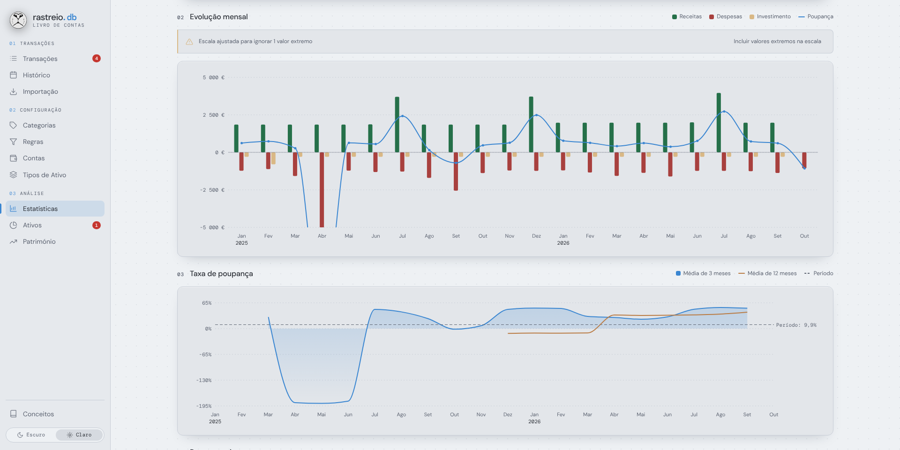
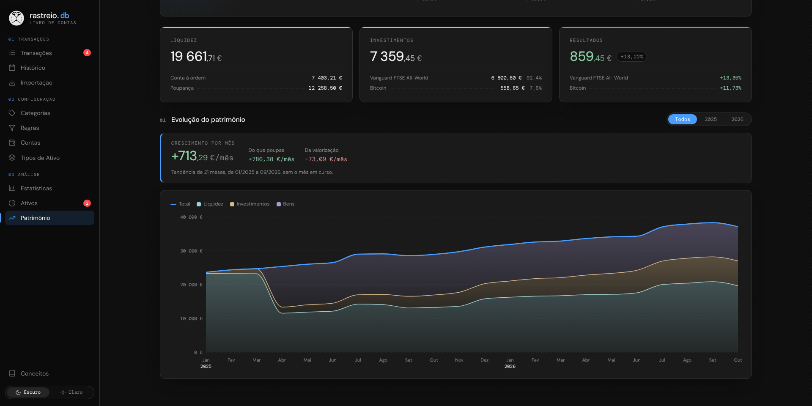
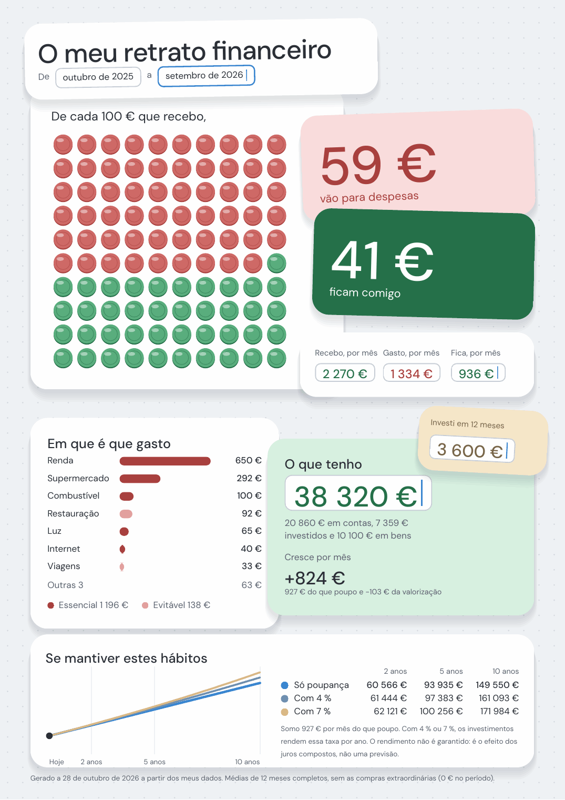

  

<h1 align="center">Rastreio-DB</h1>

  <a href="https://github.com/pedro-f-97/rastreio-db/releases/latest">⬇️ Download da versão mais recente</a>

  <strong>Python • FastAPI • React • SQLite • SQLAlchemy • PyInstaller</strong>

Aplicação local para gerir e analisar extractos bancários, sem serviços externos. Nasceu para substituir a típica folha de Excel: importa os extractos, categoriza as transações com regras e acompanha despesas, poupança e património.

### Transações
- Importação de extractos em Excel e CSV, com perfis por banco e conta, deteção de duplicados e a possibilidade de desfazer a importação mais recente
- Categorização automática por regras, com sugestões de regras novas e aplicação em massa
- Lista com edição na tabela, filtros (incluindo as transações por categorizar) e histórico com totais por ano e mês
- Verificação do saldo de cada conta contra o do extracto, com os intervalos onde está a diferença, e transações manuais para a corrigir

### Análise
- Estatísticas: evolução mensal, médias e medianas por categoria, mês típico sem as compras extraordinárias e taxa de poupança
- Ativos: investimentos e bens, com compras, vendas (FIFO) e preços
- Património: liquidez, investimentos e bens ao longo do tempo, e quanto cresce por mês
- Retrato em PDF: uma página com os hábitos dos últimos 12 meses e a projeção do património a 2, 5 e 10 anos

### Geral
- Categorias, subcategorias, regras, contas e tipos de ativo configuráveis
- Backup e restauro da base de dados
- Tema claro e escuro
- Primeiro uso com categorias predefinidas e tour guiado, e uma página de Conceitos

## Instalar e actualizar

### Instalar
1. Descarregar da [última versão](https://github.com/pedro-f-97/rastreio-db/releases/latest) o `rastreio-db-windows.zip` (Windows) ou o `rastreio-db-linux.tar.gz` (Linux)
2. Extrair para uma pasta à escolha
3. Correr `rastreio-db.exe` (Windows) ou `./rastreio-db` (Linux). O browser abre em `http://localhost:9742`, e uma pequena janela permite reabri-lo ou encerrar a aplicação

### Onde ficam os dados
Todos os dados ficam num só ficheiro, `dados/rastreio.db`, dentro da pasta da aplicação. Apagar a pasta `dados/` é perder todos os dados.

### Actualizar
1. Na página Transações, fazer **Exportar DB** para guardar um backup
2. Encerrar a aplicação
3. Extrair a versão nova para uma pasta nova
4. Copiar a pasta `dados/` da versão antiga para a pasta da versão nova
5. Correr a versão nova. Se algo correr mal, a versão antiga continua intacta na sua pasta

## Preview

As capturas usam dados de demonstração. As principais estão no tema claro e as restantes no escuro.

### Transações (categorização na tabela, filtros e um separador por mês)

### Estatísticas (resumo, mês típico, evolução mensal, taxa de poupança e distribuição da despesa)

### Património (total, composição, crescimento por mês e evolução)

### Retrato em PDF (os hábitos dos últimos 12 meses e a projeção do património)

  

Mais screenshots (Importação, Categorias, Regras, Histórico, Contas, Ativos e Conceitos)

### Importação

### Menu de importação

### Categorias

### Regras de categorização automática

### Histórico

### Contas

### Ativos

### Tipos de ativo

### Tratar ativo (contabilização FIFO)

### Conceitos

## Limitações

- Armazenamento local apenas - sem sincronização entre dispositivos ou cloud - é recomendado utilizar métodos comuns de backup
- Utilizador único, sem gestão de múltiplos perfis
- Tudo é em euros: um ativo cotado noutra moeda (ex. um ETF em dólares) tem de ter os preços escritos já convertidos para euros
- As transações entram por importação de extractos; criá-las à mão serve só para corrigir o saldo de uma conta

## Documentação adicional

- [Decisões de design](docs/decisoes.md): como se conta cada coisa e porquê
- [Arquitetura do projeto](docs/arquitectura.md)
- [Modelo de dados](docs/modelo-dados.md)
- [Guia de desenvolvimento](docs/desenvolvimento.md)

## Licença

Este projeto está licenciado sob a [GNU General Public License v3.0](LICENSE).
